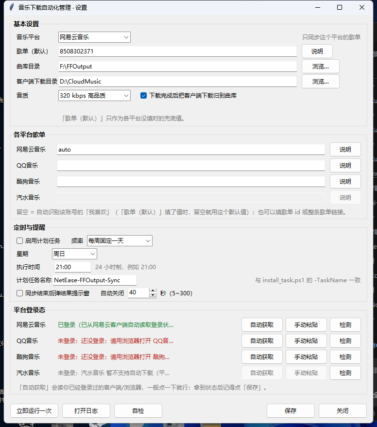

# 音乐下载自动化管理

把音乐平台「我喜欢」里的歌，定时补齐到本地曲库的小工具（Windows / macOS）。

仓库名 `music-download-manager`，Python 包名 `music_sync`（沿用旧名，不改 import）。
不联网上传、不碰你的账号密码，只是拿你自己已登录的会话去读歌单、下歌。



## 它能干什么

- **对账补缺**：拉你歌单里的曲目，和本地曲库比一遍，缺哪首下哪首，已有的直接跳过。
- **各平台歌单互不干扰**：网易云、QQ音乐、酷狗可以各填自己的歌单；留空就自动按名字去找你账号里的「我喜欢」。
- **多平台**：网易云音乐、QQ音乐、酷狗音乐可以下载；汽水音乐只有占位适配器（见「已知限制」）。
- **少手动**：网易云直接用客户端本地的登录态；QQ音乐/酷狗可以一键读浏览器里已经登录的状态，实在不行才手动粘。
- **定时跑**：注册系统定时任务（Windows 计划任务 / macOS launchd），每周固定一天 / 每天 / 每隔 N 小时跑一次；跑完右下角弹一个小窗告诉你下了几首。
- **跨平台补源**：主平台没版权或者下不动的歌，只要能换源，会用其它已登录平台的同名曲补上。
- **归置文件**：客户端（网易云/QQ音乐）自己下载的歌，默认放在它们的下载目录里，可以自动搬进你的曲库。
- **能自检**：一条命令查依赖、目录、网络、登录态、计划任务有没有装好。

## 环境要求

- **Windows 10 / 11** 或 **macOS 12 及以上**（Intel / Apple Silicon 都行）
- Python 3.9 或更高（开发和测试用的是 3.13）
- 能联网，装依赖时需要网络

依赖只有两个：`requests`、`cryptography`（后者用于读网易云客户端加密过的登录数据）。

## 三步装好

### 1. 装依赖

```bash
cd music-sync
python3 -m venv .venv
source .venv/bin/activate        # Windows: .venv\Scripts\activate
pip install -r requirements.txt
```

不需要 `pip install` 本仓库——直接在项目目录里用 `python -m music_sync` 运行。

### 2. 打开设置，填一遍

```bash
python -m music_sync settings
```

窗口里从上到下依次填：

1. **音乐平台 / 歌单（默认）/ 曲库目录**：歌单可以填 id 也可以直接粘链接；曲库目录点「浏览…」选。
2. **各平台歌单**：四个平台各一行，想同步哪个歌单就填哪个，互不影响。**留空最省事**——工具会按名字去你账号里找「我喜欢 / 我喜欢的音乐 / 喜欢的音乐 / 我的收藏」这类默认收藏歌单。只有自动识别不到（或者你想同步别的歌单）时，才需要填 id 或链接。
3. **音质**：320 / 192 / 128 / 无损。无损只有部分平台支持，选了不支持的平台，下面会有一行小字提醒会自动降级。
4. **平台登录态**：先试「自动获取」——它会去读你网易云客户端或浏览器里已经登录好的状态；不行再点「手动粘贴」。
5. **定时与提醒**：要不要定时、多久一次、几点、结果弹窗几秒后自动关。
6. 点 **保存**。

### 3. 注册计划任务

**Windows**：设置界面的「计划任务名称」要和脚本的 `-TaskName` 一致，然后用脚本注册（推荐）：

```powershell
# 每周日 21:00
powershell -NoProfile -ExecutionPolicy Bypass -File scripts\install_task.ps1 -Weekly -Weekday Sunday -Time 21:00

# 每天 21:00
powershell -NoProfile -ExecutionPolicy Bypass -File scripts\install_task.ps1 -Daily -Time 21:00

# 每隔 24 小时
powershell -NoProfile -ExecutionPolicy Bypass -File scripts\install_task.ps1 -Hours 24
```

**macOS**：同一个命令换个脚本名，背后是 `launchd` 的 LaunchAgent（装在 `~/Library/LaunchAgents`，不用 sudo）：

```bash
chmod +x scripts/install_task.sh
./scripts/install_task.sh --weekly --weekday 7 --time 21:00   # 每周日 21:00（周一=1 … 周日=7）
./scripts/install_task.sh --daily --time 21:00
./scripts/install_task.sh --hours 24
./scripts/install_task.sh --remove        # 取消定时
```

嫌脚本麻烦的话，命令行入口两边通用：

```bash
python -m music_sync task --weekly --weekday Sunday --time 21:00
```

脚本是幂等的（先删再建），改时间就再跑一次。想先看看会下什么、但不下：

```bash
python -m music_sync sync --dry-run
python -m music_sync check        # 环境自检（Windows 上写作 :: 也行）
python -m music_sync platforms    # 列出平台和登录态
```

## 每个平台怎么登录

| 平台 | 能不能下载 | 登录怎么做 |
| --- | --- | --- |
| 网易云音乐 | 能 | 打开网易云客户端登录一次就够了，工具会自己去读本地登录状态，**不用填任何东西**。实在读不到时，浏览器登录后点「自动获取」当兜底。 |
| QQ音乐 | 能（接口未在真机账号验证） | 浏览器登录 QQ音乐网页 → 设置里点「自动获取」。还不行就「手动粘贴」：F12 → Network → 刷新 → 任意请求的 Request Headers 里找 `Cookie`，整行值复制进去。 |
| 酷狗音乐 | 能（接口未在真机账号验证） | 同上，浏览器登录后点「自动获取」。 |
| 汽水音乐 | **不能**（只有占位适配器） | 没有公开接口，登录和下载都不可用，只保留平台位方便以后补。 |

命令行也能查/取登录态：

```bat
python -m music_sync login            :: 所有平台过一遍
python -m music_sync login netease    :: 只取网易云（会自动写入配置文件）
```

登录态会以 `cookie` 字符串存在 `config.json` 里。这个文件等于你的登录凭证，别发给别人、别提交到 git。

## 配置文件字段

默认路径 `~/.music-sync/config.json`（`~` 是你的用户目录）。两种改法：

- 环境变量 `MUSIC_SYNC_HOME` 换配置目录；
- 命令行/快捷方式加 `--config D:\somewhere\config.json` 指定文件。

缺字段会自动补默认值，手改坏了大不了删掉重来。

### 顶层

| 字段 | 默认值 | 含义 |
| --- | --- | --- |
| `platform` | `"netease"` | 用哪个平台当主来源：`netease` / `qqmusic` / `kugou` / `soda` |
| `playlist` | `"8508302371"` | 旧的全局歌单，只当兜底：各平台没单独填时用它。也支持 id 或整条链接 |
| `library_dir` | `"F:\\FFOutput"` | 曲库目录，下载和判重都在这里 |
| `client_download_dir` | `"D:\\CloudMusic"` | 客户端下载目录；留空表示不归置 |
| `quality` | `"320"` | 音质：`320` / `192` / `128` / `lossless` |
| `auto_move` | `true` | 是否把客户端下载目录里的歌搬进 `library_dir` |
| `ignore_ids` | `[]` | 不想再同步的曲目 id 列表（手动排除某些歌） |

### `schedule`（定时）

| 字段 | 默认值 | 含义 |
| --- | --- | --- |
| `enabled` | `true` | 是否启用定时（设置界面里的复选框） |
| `mode` | `"weekly"` | `weekly` 每周 / `daily` 每天 / `hours` 每隔 N 小时 |
| `weekday` | `"sunday"` | `weekly` 时用，`monday`…`sunday` |
| `time` | `"21:00"` | `weekly`/`daily` 时用，24 小时制 `HH:MM` |
| `hours` | `168` | `mode=hours` 时的间隔小时数，1~8760 |
| `task_name` | `"MusicSync"` | 定时任务名，要和 `install_task.ps1 -TaskName` / `install_task.sh --task-name` 一致 |

### `notify`（跑完的提示窗）

| 字段 | 默认值 | 含义 |
| --- | --- | --- |
| `toast` | `true` | 同步结束后要不要弹右下角结果窗 |
| `timeout` | `40` | 提示窗几秒后自动关，5~300 |

### `download`（下载细节）

| 字段 | 默认值 | 含义 |
| --- | --- | --- |
| `ext` | `"mp3"` | 保存的文件扩展名 |
| `retries` | `3` | 单曲最多重试几次 |
| `sleep` | `0.4` | 每首之间等多少秒（别把人家服务器打爆） |
| `overwrite` | `false` | 已存在同名文件要不要覆盖 |

### `platforms`（各平台登录信息 + 各平台歌单）

| 字段 | 默认值 | 含义 |
| --- | --- | --- |
| `platforms.netease.cookie` | `""` | 网易云登录凭证（一般留空由工具自动读取） |
| `platforms.netease.client_app_dir` | `""` | 网易云客户端数据目录，留空＝用默认安装位置 |
| `platforms.netease.playlist` | `""` | 网易云自己的歌单 id / 链接；**留空＝自动识别「我喜欢」** |
| `platforms.qqmusic.cookie` | `""` | QQ音乐登录凭证 |
| `platforms.qqmusic.playlist` | `""` | QQ音乐自己的歌单；留空＝自动识别（QQ音乐的「我喜欢」是固定的 `201` 号歌单） |
| `platforms.kugou.cookie` | `""` | 酷狗登录凭证 |
| `platforms.kugou.playlist` | `""` | 酷狗自己的歌单；留空＝按名字找「我喜欢」，找不到会提示你手填 |
| `platforms.soda.cookie` | `""` | 汽水音乐预留字段（暂无实现） |
| `platforms.soda.playlist` | `""` | 汽水音乐预留字段（暂无实现） |

各平台歌单可以不同，一个例子：

```json
{
  "platform": "netease",
  "playlist": "",
  "platforms": {
    "netease": { "playlist": "" },
    "qqmusic": { "playlist": "https://y.qq.com/n/ryqq/playlist/7263829103" },
    "kugou": { "playlist": "123456" },
    "soda": {}
  }
}
```

顶层 `playlist` 是兜底值：某个平台自己留空时先用它，它也留空才去自动识别。上面这个例子里网易云两处都留空 → 自动找账号里的「我喜欢」；QQ音乐填了整条链接、酷狗填了歌单 id → 各用各的；汽水没有公开接口，填了也不会生效。

## 常见问题

**Q：跑完了但没弹结果窗？**
多半是被安全软件拦了。火绒 → 防护中心 → 弹窗拦截 → 添加程序，把 `pythonw.exe`（和你的 python.exe）加进白名单。命令行自检也能提示这一点：`python -m music_sync check`。

**Q：明明下过了，还重复下 / 歌名对不上？**
工具认的文件名是 **`歌手 - 歌名.mp3`**（中间是空格-空格）。原来的文件名是 `歌名 - 歌手` 或者纯歌名，它就会当成没下过。有两种办法：把本地文件名改成上面的格式，或者在设置里把 `overwrite`/判重相关的东西想清楚再跑 `--dry-run` 看看清单。版本词（`(Live)`、`(Remix)`、`(伴奏)`）会被当成不同的曲子，别随手删。

**Q：换了平台（或者换了账号），歌单怎么对不上了？**
因为各平台「我喜欢」的歌单 id 并不通用：网易云是「我喜欢的音乐」那个特殊歌单，QQ音乐固定是 `201` 号歌单，酷狗是账号自己的 `specialid`——id 不一样，名字也不一样。工具的做法是：设置里那一行**留空**时，按名字去你账号的歌单列表里找默认收藏（「我喜欢 / 我喜欢的音乐 / 喜欢的音乐 / 我的收藏」这类叫法都认），找到就用；找不到会在日志里说清楚，让你手动填 id 或链接。所以换平台后先看一眼设置里「各平台歌单」那一行是不是还留着旧平台的 id——填了值就只读它，清空就恢复自动识别。

**Q：网易云报 404 是什么？**
这首没有版权，或者需要会员/付费才能听。工具会跳过它并把歌名列进失败清单，不会重试到天荒地老。

**Q：提示 `No module named 'cryptography'`？**
依赖没装全，回去跑一遍 `pip install -r requirements.txt`。没有它读不了网易云客户端的登录数据，其它平台不受影响。

**Q：计划任务到点了没反应？**
先看任务有没有跑过：`schtasks /Query /TN MusicSync /V /FO LIST`。注意任务的「工作目录」必须是项目根目录——用 `scripts\install_task.ps1` 注册就自动设好了，手动在任务计划程序里建容易漏。电脑当时在睡眠/关机也没关系，勾了「错过就开始」会在下次开机后补跑。

**Q：macOS 上定时任务到点了没反应？**
`launchctl print gui/$(id -u)/com.thr128.music-sync.<任务名>` 看状态，日志在 `~/Library/Logs/music-sync/`。注意 macOS 的 launchd 在睡眠期间错过的触发**不会补跑**（这点和 Windows 不一样），长时间合盖的话建议改用「每隔 N 小时」模式。

**Q：macOS 上「自动获取」拿不到浏览器登录态？**
macOS 把浏览器数据放在受保护目录，命令行进程默认读不到。第一次会弹权限框，允许就行；没弹的话去「系统设置 → 隐私与安全性 → 完全磁盘访问权限」里把终端（或运行它的程序）打开。也可以干脆用网易云客户端登录——那条路不需要额外权限。

**Q：QQ音乐/酷狗一直显示未登录？**
这两个平台靠浏览器会话。先在 Chrome/Edge 里登录对应网页版，回到设置窗口点「自动获取」。浏览器用的是别的账号或者开了无痕窗口，工具就读不到。

## 卸载

```bash
# Windows
powershell -NoProfile -ExecutionPolicy Bypass -File scripts\install_task.ps1 -TaskName MusicSync -Remove

# macOS
./scripts/install_task.sh --remove
# 或手动：launchctl bootout gui/$(id -u) ~/Library/LaunchAgents/com.thr128.music-sync.*.plist
```

然后把 `music-sync` 文件夹删掉（建过 `.venv` 就一起删）。配置和日志在 `~/.music-sync`（Windows）或 `~/Library/Application Support/music-sync`（macOS），想重来就先删它们。

没有注册表项、没有开机自启、没有常驻服务，删完就干净了。

## 已知限制

说清楚，免得白折腾：

- **汽水音乐只有占位适配器**，不能登录、不能下载，只占个平台位。选它当主平台会直接报错。
- **QQ音乐 / 酷狗音乐的下载接口没有在真机账号上验证过**。代码是按公开接口写的，能跑通对账和登录检测，但真正下单/取地址的环节可能因为对方接口改动而失效，出问题请以日志为准。
- **macOS 支持是 1.1.0 新增的**，在 Windows 上完成开发和自测，macOS 侧的关键环节（钥匙串取密钥、launchd 注册、Safari 读取、完全磁盘访问权限）**尚未在真机验证**。用自检命令 `python -m music_sync check` 会逐项告诉你哪里没通。
- Linux 能跑对账和下载，但定时任务暂不支持（给的理由和替代做法：自己挂 cron）。
- 歌单里需要会员才能听的歌，没有会员账号就是下不到，这不是 bug。
- 留空自动识别「我喜欢」也要看平台接口给不给力：酷狗的默认收藏不是公开歌单，接口拿不到时会让你在设置里手填 id；任何平台识别失败都只会在日志里说清楚，不会猜。
- 请只用来管理**你自己账号**的歌单，别拿去做批量分发或商业用途。

## 目录结构

```
music-sync/
├─ music_sync/            主程序包
│  ├─ config.py           配置读写
│  ├─ platforms/          各平台适配器（netease/qqmusic/kugou/soda）
│  ├─ matching.py         歌名对账
│  ├─ sync.py             同步主流程
│  ├─ login.py            登录态获取（客户端 → 浏览器 → 配置）
│  ├─ browser_cookies.py  读 Chrome/Edge/Safari 等浏览器的登录数据（Windows/macOS）
│  ├─ ospaths.py          平台差异出口（路径、浏览器配置目录、客户端位置）
│  ├─ schedule.py         定时任务（Windows 计划任务 / macOS launchd）
│  ├─ selfcheck.py        环境自检
│  ├─ cli.py / __main__.py  命令行入口
│  └─ ui/                 设置界面、结果提示窗
├─ scripts/
│  ├─ install_task.ps1    注册/更新/删除计划任务（Windows）
│  └─ install_task.sh     注册/更新/删除定时任务（macOS）
├─ docs/
│  ├─ devlog-entry.md     发布说明稿
│  └─ settings.png        设置界面截图
├─ tests/                 单元测试（pip install -r requirements-dev.txt && python -m pytest tests）
├─ requirements.txt       运行依赖
├─ requirements-dev.txt   测试依赖（pytest）
└─ LICENSE
```

## 许可

MIT，见 [LICENSE](LICENSE)。
